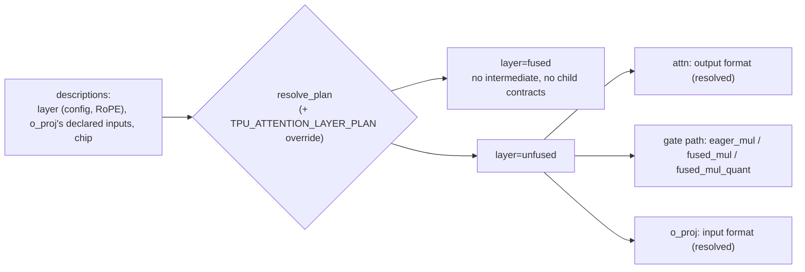

**Scopes group** (`prototype/scopes/`). Backs DATA_CONTRACTS.md section 5.3 (the tree in miniature) and section 5.10 (the guards). Siblings: `prototype/scopes/declared-blocks`, `prototype/scopes/fork-migration`.

# Prototype: the attention layer boundary is the only contract

This prototype applies sections 3 and 5.1 to 5.3 to one upstream
layer, vLLM's `Qwen3NextAttention`. It shows that once the layer is registered
as an expansion point, only its boundary is a contract:

- **Contract**: `(positions, hidden_states) -> output`, with the output's shape,
  dtype, sharding and tolerance, plus the weights and config. Nothing else
  crosses the boundary.
- **Plan**: everything inside the boundary. One frozen `AttentionLayerPlan` is
  resolved once in `__init__`, and the forward matches on it.

## Where to look

| Claim | Code |
|---|---|
| The model-local layer, the tree in miniature | [`TpuQwen3NextAttention`](../src/vllm_torchtpu/models/vllm/qwen3_next_attention.py#L198-L289) in `qwen3_next_attention.py` (L198-L289) |
| The contract is the boundary | [`AttentionLayerContract, layer_contract`](../src/vllm_torchtpu/layers/attention_layer_plan.py#L164-L201) in `attention_layer_plan.py` (L164-L201) |
| The plan types | [`ActivationFormat ... AttentionLayerPlan`](../src/vllm_torchtpu/layers/attention_layer_plan.py#L208-L232) in `attention_layer_plan.py` (L208-L232) |
| Capability, with reasons | [`supports_fused_*`](../src/vllm_torchtpu/layers/attention_layer_plan.py#L282-L328) in `attention_layer_plan.py` (L282-L328) |
| Precedence | [`resolve_plan`](../src/vllm_torchtpu/layers/attention_layer_plan.py#L582-L627) in `attention_layer_plan.py` (L582-L627) |
| The forward follows the plan | [`_apply_gate, forward`](../src/vllm_torchtpu/models/vllm/qwen3_next_attention.py#L123-L289) in `qwen3_next_attention.py` (L123-L289) |
| Guards (section 5.10) | [`_guard_signatures, check_parameter_names`](../src/vllm_torchtpu/layers/expansion.py#L61-L80) in `expansion.py` (L61-L80) |
|  | [`expansion_point`](../src/vllm_torchtpu/layers/expansion.py#L123-L134) in `expansion.py` (L123-L134) |
| The owner registry | [`ExpansionPoint, ExpansionKey, EXPANSION_POINTS`](../src/vllm_torchtpu/patch_registry.py#L177-L210) in `patch_registry.py` (L177-L210) |
| Planted checks | [`PLANTED, check_outside_write`](../prototype/check_attention.py#L44-L151) in `check_attention.py` (L44-L151) |
| Plan types marked with their owner | [`UnfusedLayerPlan, FusedLayerPlan`](../src/vllm_torchtpu/layers/attention_layer_plan.py#L217-L232) in `attention_layer_plan.py` (L217-L232) |
| Plan invariance, structural tier and numerics on a CPU | [`check_config`](../prototype/check_attention_plans.py#L96-L184) in `check_attention_plans.py` (L96-L184) |
| The layer with seeded weights, no TPU runtime, attention as a reference child | [`RefAttention, build_real`](../prototype/_cpu.py#L55-L101) in `_cpu.py` (L55-L101) |
| Numerics tier for a TPU (prepared) | [`main`](../prototype/check_attention_values.py#L42-L76) in `check_attention_values.py` (L42-L76) |

It writes no new kernel. The whole layer as one fused kernel is a plan value
(`layer=fused`) whose `supports()` declines with "no fused attention-layer
kernel registered". If such a kernel existed, it would be one more plan
value. Neither the contract nor any caller would change.

## The problem: three decisions, three places

**In upstream `Qwen3NextAttention`, each fusion choice is made somewhere
different.** The plugin pins vLLM v0.33.0. The newer vLLM adds the last two
rows.

| Decision | Where upstream makes it | v0.33.0 | newer vLLM |
|---|---|---|---|
| `use_fused_qk_norm_rope_gate` | `__init__`, from the RoPE module type, the dtype, the platform and the multimodal config | yes | yes |
| `use_fused_output_gate` | set to `False` in `__init__`, then to `True` by `Qwen3_5DecoderLayer` (`vllm/models/qwen3_5/nvidia/model.py:328`), from outside the layer | absent | yes |
| Fuse the gate with o_proj's FP8 input quantization | the forward checks `get_input_quant_key(self.o_proj) == kFp8StaticTensorSym` | absent | yes |

`__init__` makes other choices too, but they are config facts rather than
fusion choices: whether KV heads are partitioned or replicated, `attn_output_gate`, the
dual-chunk attention arguments, and causal versus encoder-only attention. The
forward has one more branch, the gate split, which follows from
`attn_output_gate`. In newer vLLM, `fused_sigmoid_gate_mul` also re-checks
eligibility itself and falls back to eager, which is a fourth place where the
same decision is made.

## The design: one plan, handed down



- **Registration.** `@expansion_point` (`src/vllm_torchtpu/layers/expansion.py`)
  decorates a subclass of the upstream class. It mirrors
  `PluggableLayer.register_oot` and takes no dotted-string targets. For an upstream that is not
  a `PluggableLayer`, it installs one `__new__` with the same lookup. Its guard
  compares the upstream `__init__` and `forward` signatures at registration.
  `check_parameter_names` compares parameter names on a layer built on the meta device.
- **Ownership.** Each expansion point has an entry in
  `patch_registry.EXPANSION_POINTS`, keyed by the `ExpansionKey` the replacement declares as its `expansion_key`. Whoever registers an expansion point owns its plan, its guard
  failures and keeping it in step with upstream. If a family later adopts
  the layer's fused path for reuse, ownership moves to that family. Here the
  owner is the `qwen3-next model team`.
- **Plan** (`src/vllm_torchtpu/layers/attention_layer_plan.py`).
  `AttentionLayerPlan = UnfusedLayerPlan | FusedLayerPlan`: the two paths
  are two types, dispatched by type, and every field is an enum. On the unfused path the plan also resolves the contracts it hands
  down: the attention kernel's output format and o_proj's input format, as
  `ActivationFormat(dtype, quant, scale)` with no defaults. o_proj therefore
  receives its input format from the plan; the forward no longer peeks at
  `get_input_quant_key(o_proj)`. What o_proj *can* accept is read as declared
  capability. On the fused path those types do not exist.
- **Capability.** Each variant has a `supports(...)` that takes its kernel's
  arguments and returns a reason when it cannot run. A single rule, carried over
  from upstream, picks the fused QK kernel wherever it can run. The fused
  sigmoid gate has no rule, so only the override reaches it. That override is
  what replaces Qwen3.5's outside write.
- **Override.** The user's `TPU_ATTENTION_LAYER_PLAN` and the model plan
  (read from the model's config as its model plan, `tpu_attention_layer_plan`)
  are partial plans whose unset fields are `None`, each parsed once from its
  text (`parse_pins`) into enum values. Precedence follows the tree:
  user, model plan, the rule, the default. The two merge field by field, so a
  user pin takes precedence over the model plan's pin rather than contradicting
  it. Resolution fills the unpinned fields, then checks the consistency of each
  source's own pins, that no contract field is pinned, that some plan matches,
  and each variant's `supports(...)`. Any failure raises when the layer is
  built. The plan records which source decided each field.
- **Read-only decisions.** `use_fused_qk_norm_rope_gate` and
  `use_fused_output_gate` become properties derived from `self.plan`.
  Upstream `__init__`'s own writes are recorded, not obeyed; its
  `use_fused_qk_norm_rope_gate` must equal the plan's capability check on
  vLLM's platform (`check_upstream_decision`), or the build raises. Any
  later write raises.

## Plan invariance

**The attention layer's plan is checked the same way as the MoE combine's**
(`prototype/checks/moe-plan-invariance`): every plan value is forced, the
outcome is compared with what the layer declares, each field is flipped, and
each runnable value's output is compared with a reference within the
contract's tolerance.

- **Structural tier, on a CPU.** The MoE combine compiles JAX for a TPU
  topology described without a device. This layer is PyTorch, and a TPU
  compile of PyTorch needs the device, so the structural tier here is the
  graph `torch.export` produces, which is the same for every backend.
- **The attention kernel stays out of scope.** The layer's plan hands the
  attention child only its output format, so `_cpu` replaces the kernel with
  a plain causal grouped-query attention. The check covers the layer's own
  decisions.
- **No TPU runtime.** `_cpu` keeps vLLM from detecting the TPU and maps the
  plugin's packages without running their `__init__` files, so this command
  needs no lock.

```bash
PYTHONPATH=.:src:<vllm-v0.33.0> python -m prototype.check_attention_plans
```

Output on a CPU host (about 10 s; vLLM's warnings on standard error omitted):

```text
== gated: 7 plan values, owner ['attention_layer']
  t=1   layer=fused
        declared declines; fails (AssertionError: no fused attention-layer kernel); agrees
  t=1   layer=unfused,qk_norm_rope_gate=eager,gate=eager_mul,o_proj_input=none
        declared capable; exports; agrees
  t=1   layer=unfused,qk_norm_rope_gate=eager,gate=fused_mul,o_proj_input=none
        declared declines; fails (AssertionError: ); agrees
  t=1   layer=unfused,qk_norm_rope_gate=eager,gate=fused_mul_quant,o_proj_input=fp8_static_tensor_sym
        declared declines; fails (AssertionError: ); agrees
  t=1   layer=unfused,qk_norm_rope_gate=fused_triton,gate=eager_mul,o_proj_input=none
        declared declines; fails (AttributeError: module 'triton' has no attribute 'next_power_of_2'); agrees
  t=1   layer=unfused,qk_norm_rope_gate=fused_triton,gate=fused_mul,o_proj_input=none
        declared declines; fails (AttributeError: module 'triton' has no attribute 'next_power_of_2'); agrees
  t=1   layer=unfused,qk_norm_rope_gate=fused_triton,gate=fused_mul_quant,o_proj_input=fp8_static_tensor_sym
        declared declines; fails (AttributeError: module 'triton' has no attribute 'next_power_of_2'); agrees
  field attn_output: fixed (one value wherever it exists: ActivationFormat(dtype=torch.bfloat16, quant=<Quant.NONE: 'none'>, scale=<Scale.NONE: 'none'>))
  field gate: no exportable single-field flip to compare
  field layer: no exportable single-field flip to compare
  field o_proj_input: no exportable single-field flip to compare
  field qk_norm_rope_gate: no exportable single-field flip to compare
  numerics layer=unfused,qk_norm_rope_gate=eager,gate=eager_mul,o_proj_input=none vs upstream forward: max |diff| 0.0e+00 (atol 0.02, rtol 0.016)
== no_gate: 3 plan values, owner ['attention_layer']
  t=1   layer=fused
        declared declines; fails (AssertionError: no fused attention-layer kernel); agrees
  t=1   layer=unfused,qk_norm_rope_gate=eager,gate=none,o_proj_input=none
        declared capable; exports; agrees
  t=1   layer=unfused,qk_norm_rope_gate=fused_triton,gate=none,o_proj_input=none
        declared declines; fails (ValueError: Split sizes add up to 192 but got the tensor's size of 128); agrees
  field attn_output: fixed (one value wherever it exists: ActivationFormat(dtype=torch.bfloat16, quant=<Quant.NONE: 'none'>, scale=<Scale.NONE: 'none'>))
  field gate: fixed (one value wherever it exists: <GatePath.NONE: 'none'>)
  field layer: no exportable single-field flip to compare
  field o_proj_input: fixed (one value wherever it exists: ActivationFormat(dtype=torch.bfloat16, quant=<Quant.NONE: 'none'>, scale=<Scale.NONE: 'none'>))
  field qk_norm_rope_gate: no exportable single-field flip to compare
  numerics layer=unfused,qk_norm_rope_gate=eager,gate=none,o_proj_input=none vs upstream forward: max |diff| 0.0e+00 (atol 0.02, rtol 0.016)
findings: 0 (0 new)
```

**What it shows.**

- **Every declaration agrees with the outcome.** Each value the layer
  declines also fails when forced, for the reason its `supports()` gives:
  no fused layer kernel, no `fused_sigmoid_gate_mul` in vLLM v0.33.0, a
  Triton kernel on a host without Triton.
- **On a TPU the plan space has one capable value per configuration**, so
  no field can be flipped between two runnable values, and the numerics
  compare that value with upstream's forward (exactly equal here). The check
  becomes informative as soon as a second value can run on a TPU, such as a
  TPU kernel for one of the fused paths.
- **`attn_output` has one value in every plan**, and in the no-gate
  configuration so do `gate` and `o_proj_input`: these are contracts the plan
  hands down, not choices.
- **One value is listed that no chip can run:** `qk_norm_rope_gate=fused_triton`
  without an output gate, which `plan_declines` rejects and whose forced run
  fails on a split. Enumeration could leave it out.

**Numerics tier on a TPU (prepared, not run).** `check_attention_values`
moves each value declared capable on a TPU to the device and compares it with
the float32 CPU reference within the contract's tolerance:

```bash
flock /tmp/vt-tpu.lock env PYTHONPATH=.:src:<vllm-v0.33.0> \
    python -m prototype.check_attention_values
```

**Where PR #3096 would enter.** vllm-project/vllm-torchtpu#3096 (open) adds
fused attention-projection Pallas kernels. Its `out_proj` kernel computes
inside this layer's boundary, so it enters as one more plan value of this
layer's plan (for example a `gate`/`o_proj` variant whose `supports()` states
the kernel's limits), and this check would then compare two runnable values
on a TPU. Its `fused_qkv` and `fused_gdn` kernels start with the input
RMSNorm and the residual add, which belong to the decoder layer, not to the
attention layer, so they cross the norm-to-attention boundary: by the
smallest-scope rule their choice belongs to block scope, as a value of a
declared block's plan (section 5.3), not to this layer.

## Commands

Both commands run on a CPU against the plugin's pinned vLLM v0.33.0 and build
the layer on the meta device. Importing the plugin loads libtpu, so on a TPU
VM run them under the TPU lock. They assume vLLM v0.33.0; with a newer vLLM
the layer fails at `VllmConfig` setup, so put a v0.33.0 checkout on the path
with `PYTHONPATH=src:<vllm-v0.33.0>`:

```bash
JAX_PLATFORMS=cpu PYTHONPATH=src python -m prototype.attention_plan
JAX_PLATFORMS=cpu PYTHONPATH=src python -m prototype.check_attention
```

### `prototype.attention_plan`

For each config, this prints the contract, the resolved plan with the
contracts it hands down, and every plan value with its decline reasons. "CUDA description" means
the chip description is CUDA's; the layer is still built here. The last config
replaces o_proj's declared inputs with what newer vLLM's FP8 o_proj declares.
The last block builds the layer with a user override and a model plan: a
partial pin completed, a user pin taking precedence over the model plan's pin,
a contradictory override, and a contract pin.

```
=== gated output, TPU
contract
  positions      (num_tokens) int64, replicated
  hidden_states  (num_tokens, 64) bfloat16, replicated
  output         (num_tokens, 64) bfloat16, replicated
  tolerance      atol=0.02 rtol=0.016
  weights        qkv_proj.weight[192, 64], o_proj.weight[64, 64], q_norm.weight[16], k_norm.weight[16]
resolved plan    layer=unfused,qk_norm_rope_gate=eager,gate=eager_mul,o_proj_input=none
  hands down     attn output bfloat16/none; gate eager_mul; o_proj input bfloat16/none
plan values
  declines layer=fused
           hands down: no submodule contracts (no intermediate)
           - no fused attention-layer kernel registered
  capable  layer=unfused,qk_norm_rope_gate=eager,gate=eager_mul,o_proj_input=none
           hands down: attn output bfloat16/none; gate eager_mul; o_proj input bfloat16/none
  declines layer=unfused,qk_norm_rope_gate=eager,gate=fused_mul,o_proj_input=none
           hands down: attn output bfloat16/none; gate fused_mul; o_proj input bfloat16/none
           - fused_sigmoid_gate_mul: fused_sigmoid_gate_mul is not in this vLLM (added after v0.33.0)
  declines layer=unfused,qk_norm_rope_gate=eager,gate=fused_mul_quant,o_proj_input=fp8_static_tensor_sym
           hands down: attn output bfloat16/none; gate fused_mul_quant; o_proj input float8_e4m3fn/fp8_static_tensor_sym @o_proj.input_scale
           - fused_sigmoid_gate_mul: fused_sigmoid_gate_mul is not in this vLLM (added after v0.33.0)
           - o_proj does not accept fp8_static_tensor_sym input
  declines layer=unfused,qk_norm_rope_gate=fused_triton,gate=eager_mul,o_proj_input=none
           hands down: attn output bfloat16/none; gate eager_mul; o_proj input bfloat16/none
           - fused_qk_rmsnorm_rope_gate: Triton kernel for CUDA/XPU; chip is tpu
  declines layer=unfused,qk_norm_rope_gate=fused_triton,gate=fused_mul,o_proj_input=none
           hands down: attn output bfloat16/none; gate fused_mul; o_proj input bfloat16/none
           - fused_qk_rmsnorm_rope_gate: Triton kernel for CUDA/XPU; chip is tpu
           - fused_sigmoid_gate_mul: fused_sigmoid_gate_mul is not in this vLLM (added after v0.33.0)
  declines layer=unfused,qk_norm_rope_gate=fused_triton,gate=fused_mul_quant,o_proj_input=fp8_static_tensor_sym
           hands down: attn output bfloat16/none; gate fused_mul_quant; o_proj input float8_e4m3fn/fp8_static_tensor_sym @o_proj.input_scale
           - fused_qk_rmsnorm_rope_gate: Triton kernel for CUDA/XPU; chip is tpu
           - fused_sigmoid_gate_mul: fused_sigmoid_gate_mul is not in this vLLM (added after v0.33.0)
           - o_proj does not accept fp8_static_tensor_sym input

```

<details><summary>Three more configs: CUDA description, no output gate, FP8 o_proj input (newer vLLM)</summary>

```
=== gated output, CUDA description
contract
  positions      (num_tokens) int64, replicated
  hidden_states  (num_tokens, 64) bfloat16, replicated
  output         (num_tokens, 64) bfloat16, replicated
  tolerance      atol=0.02 rtol=0.016
  weights        qkv_proj.weight[192, 64], o_proj.weight[64, 64], q_norm.weight[16], k_norm.weight[16]
resolved plan    layer=unfused,qk_norm_rope_gate=fused_triton,gate=eager_mul,o_proj_input=none
  hands down     attn output bfloat16/none; gate eager_mul; o_proj input bfloat16/none
plan values
  declines layer=fused
           hands down: no submodule contracts (no intermediate)
           - no fused attention-layer kernel registered
  capable  layer=unfused,qk_norm_rope_gate=eager,gate=eager_mul,o_proj_input=none
           hands down: attn output bfloat16/none; gate eager_mul; o_proj input bfloat16/none
  declines layer=unfused,qk_norm_rope_gate=eager,gate=fused_mul,o_proj_input=none
           hands down: attn output bfloat16/none; gate fused_mul; o_proj input bfloat16/none
           - fused_sigmoid_gate_mul: fused_sigmoid_gate_mul is not in this vLLM (added after v0.33.0)
  declines layer=unfused,qk_norm_rope_gate=eager,gate=fused_mul_quant,o_proj_input=fp8_static_tensor_sym
           hands down: attn output bfloat16/none; gate fused_mul_quant; o_proj input float8_e4m3fn/fp8_static_tensor_sym @o_proj.input_scale
           - fused_sigmoid_gate_mul: fused_sigmoid_gate_mul is not in this vLLM (added after v0.33.0)
           - o_proj does not accept fp8_static_tensor_sym input
  capable  layer=unfused,qk_norm_rope_gate=fused_triton,gate=eager_mul,o_proj_input=none
           hands down: attn output bfloat16/none; gate eager_mul; o_proj input bfloat16/none
  declines layer=unfused,qk_norm_rope_gate=fused_triton,gate=fused_mul,o_proj_input=none
           hands down: attn output bfloat16/none; gate fused_mul; o_proj input bfloat16/none
           - fused_sigmoid_gate_mul: fused_sigmoid_gate_mul is not in this vLLM (added after v0.33.0)
  declines layer=unfused,qk_norm_rope_gate=fused_triton,gate=fused_mul_quant,o_proj_input=fp8_static_tensor_sym
           hands down: attn output bfloat16/none; gate fused_mul_quant; o_proj input float8_e4m3fn/fp8_static_tensor_sym @o_proj.input_scale
           - fused_sigmoid_gate_mul: fused_sigmoid_gate_mul is not in this vLLM (added after v0.33.0)
           - o_proj does not accept fp8_static_tensor_sym input

=== no output gate, TPU
contract
  positions      (num_tokens) int64, replicated
  hidden_states  (num_tokens, 64) bfloat16, replicated
  output         (num_tokens, 64) bfloat16, replicated
  tolerance      atol=0.02 rtol=0.016
  weights        qkv_proj.weight[128, 64], o_proj.weight[64, 64], q_norm.weight[16], k_norm.weight[16]
resolved plan    layer=unfused,qk_norm_rope_gate=eager,gate=none,o_proj_input=none
  hands down     attn output bfloat16/none; gate none; o_proj input bfloat16/none
plan values
  declines layer=fused
           hands down: no submodule contracts (no intermediate)
           - no fused attention-layer kernel registered
  capable  layer=unfused,qk_norm_rope_gate=eager,gate=none,o_proj_input=none
           hands down: attn output bfloat16/none; gate none; o_proj input bfloat16/none
  declines layer=unfused,qk_norm_rope_gate=fused_triton,gate=none,o_proj_input=none
           hands down: attn output bfloat16/none; gate none; o_proj input bfloat16/none
           - fused_qk_rmsnorm_rope_gate splits a gated q; no gate
           - fused_qk_rmsnorm_rope_gate: Triton kernel for CUDA/XPU; chip is tpu

=== gated output, CUDA, o_proj declares FP8 static input (newer vLLM)
contract
  positions      (num_tokens) int64, replicated
  hidden_states  (num_tokens, 64) bfloat16, replicated
  output         (num_tokens, 64) bfloat16, replicated
  tolerance      atol=0.02 rtol=0.016
  weights        qkv_proj.weight[192, 64], o_proj.weight[64, 64], q_norm.weight[16], k_norm.weight[16]
resolved plan    layer=unfused,qk_norm_rope_gate=fused_triton,gate=eager_mul,o_proj_input=none
  hands down     attn output bfloat16/none; gate eager_mul; o_proj input bfloat16/none
plan values
  declines layer=fused
           hands down: no submodule contracts (no intermediate)
           - no fused attention-layer kernel registered
  capable  layer=unfused,qk_norm_rope_gate=eager,gate=eager_mul,o_proj_input=none
           hands down: attn output bfloat16/none; gate eager_mul; o_proj input bfloat16/none
  declines layer=unfused,qk_norm_rope_gate=eager,gate=fused_mul,o_proj_input=none
           hands down: attn output bfloat16/none; gate fused_mul; o_proj input bfloat16/none
           - fused_sigmoid_gate_mul: fused_sigmoid_gate_mul is not in this vLLM (added after v0.33.0)
  declines layer=unfused,qk_norm_rope_gate=eager,gate=fused_mul_quant,o_proj_input=fp8_static_tensor_sym
           hands down: attn output bfloat16/none; gate fused_mul_quant; o_proj input float8_e4m3fn/fp8_static_tensor_sym @o_proj.input_scale
           - fused_sigmoid_gate_mul: fused_sigmoid_gate_mul is not in this vLLM (added after v0.33.0)
  capable  layer=unfused,qk_norm_rope_gate=fused_triton,gate=eager_mul,o_proj_input=none
           hands down: attn output bfloat16/none; gate eager_mul; o_proj input bfloat16/none
  declines layer=unfused,qk_norm_rope_gate=fused_triton,gate=fused_mul,o_proj_input=none
           hands down: attn output bfloat16/none; gate fused_mul; o_proj input bfloat16/none
           - fused_sigmoid_gate_mul: fused_sigmoid_gate_mul is not in this vLLM (added after v0.33.0)
  declines layer=unfused,qk_norm_rope_gate=fused_triton,gate=fused_mul_quant,o_proj_input=fp8_static_tensor_sym
           hands down: attn output bfloat16/none; gate fused_mul_quant; o_proj input float8_e4m3fn/fp8_static_tensor_sym @o_proj.input_scale
           - fused_sigmoid_gate_mul: fused_sigmoid_gate_mul is not in this vLLM (added after v0.33.0)

```

</details>

```
=== overrides, gated output, TPU
  user='gate=eager_mul' model plan=''
    layer=unfused,qk_norm_rope_gate=eager,gate=eager_mul,o_proj_input=none
    from layer=unfused (rule), qk_norm_rope_gate=eager (rule), gate=eager_mul (user), o_proj_input=none (rule)
  user='gate=eager_mul' model plan='qk_norm_rope_gate=eager,gate=fused_mul'
    layer=unfused,qk_norm_rope_gate=eager,gate=eager_mul,o_proj_input=none
    from layer=unfused (rule), qk_norm_rope_gate=eager (model plan), gate=eager_mul (user, over the model plan), o_proj_input=none (rule)
  user='layer=unfused,gate=fused_mul_quant,o_proj_input=none' model plan=''
    raises ValueError: attention plan layer=unfused,gate=fused_mul_quant,o_proj_input=none (user): gate=fused_mul_quant writes an FP8 o_proj input, but o_proj_input=none
  user='output=float32' model plan=''
    raises ValueError: TPU_ATTENTION_LAYER_PLAN: ['output'] belong to the layer contract; an override pins plan fields, never the contract
```

### `prototype.check_attention`

1. **Structural**: every capable plan value, for the TPU and CUDA chip
   descriptions, with and without the output gate, gives the contract's output
   shape and dtype on the meta device. Two stand-ins are needed on a CPU: the
   attention kernel is stubbed by its own contract (q-shaped output), and the
   Triton QK kernel by the outputs its docstring declares.
2. **Outside write**: `layer.use_fused_output_gate = True`, the write that
   Qwen3.5 performs, raises.
3. **Guard**: the upstream signatures and parameter names still match, and
   the expansion point has an owner.

Clean run:

```
planted: none
1 structural: every capable plan meets the contract
    tpu gated=True layer=unfused,qk_norm_rope_gate=eager,gate=eager_mul,o_proj_input=none: ((8, 64), 'bfloat16')
    tpu gated=False layer=unfused,qk_norm_rope_gate=eager,gate=none,o_proj_input=none: ((8, 64), 'bfloat16')
    cuda gated=True layer=unfused,qk_norm_rope_gate=eager,gate=eager_mul,o_proj_input=none: ((8, 64), 'bfloat16')
    cuda gated=True layer=unfused,qk_norm_rope_gate=fused_triton,gate=eager_mul,o_proj_input=none: ((8, 64), 'bfloat16')
    cuda gated=False layer=unfused,qk_norm_rope_gate=eager,gate=none,o_proj_input=none: ((8, 64), 'bfloat16')
  -> PASS
2 outside write raises
    raised: use_fused_output_gate is derived from TpuQwen3NextAttention.plan; pin a plan with TPU_ATTENTION_LAYER_PLAN instead (current: layer=unfused,qk_norm_rope_gate=eager,gate=eager_mul,o_proj_input=none)
  -> PASS
3 guard: upstream matches, owner present
    signatures: ok
    parameter names: ok
    Qwen3NextAttention: owner='qwen3-next model team'
    owner entry: ok
  -> PASS
```

Planted violations: comment in one `PLANTED = {...}` line at the top of
`prototype/check_attention.py` and rerun. Output is trimmed to the
failures:

```
planted: ['shape']
    FAIL cuda gated=True layer=unfused,qk_norm_rope_gate=fused_triton,gate=eager_mul,o_proj_input=none: ((8, 64), 'float32') != ('num_tokens', 64) bfloat16
  -> FAIL
  -> PASS
  -> PASS

planted: ['write']
  -> PASS
    FAIL layer.use_fused_output_gate = True was accepted; the plan still says layer=unfused,qk_norm_rope_gate=eager,gate=eager_mul,o_proj_input=none
  -> FAIL
  -> PASS

planted: ['signature']
  -> PASS
  -> PASS
    FAIL signatures: Qwen3NextAttention.forward changed upstream; TpuQwen3NextAttention expects (self, positions, hidden_states), found (self, positions, hidden_states, residual=None)
  -> FAIL

planted: ['param']
  -> PASS
  -> PASS
    FAIL parameter names: TpuQwen3NextAttention lacks parameters ['q_norm.weight']
  -> FAIL

planted: ['owner']
  -> PASS
  -> PASS
    FAIL owner entry: expansion point Qwen3NextAttention has no owner
  -> FAIL
```

## What this prototype does not show

- **No numerics comparison across plan values.** On TPU exactly one plan value is
  capable (eager QK, eager gate), so there is nothing to compare. The fused
  values need Triton on CUDA.
- **The FP8 gate path has not been run.** `fused_sigmoid_gate_mul` and
  `QuantizedActivation` do not exist in v0.33.0, so those plan values decline here.
- **The fused layer is not implemented.** No kernel is registered for it;
  only the plan value is shown.
