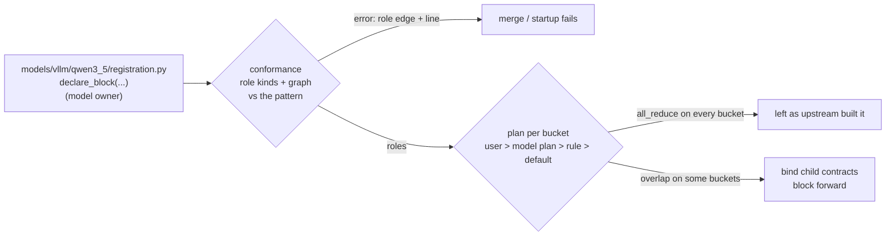

# Prototype: the attention-to-MoE overlap as a declared block

PR #1492 overlaps the collectives that join attention and MoE under tensor
parallelism: reduce-scatter `attn_partial + residual / tp`, run the norm and
the router on this rank's token shard, all-gather, and fold attention's partial
sum into the MoE all-reduce. The optimization fits any decoder layer shaped
`norm -> attention -> norm -> MoE` under TP > 1, but it landed as a Qwen3.5
monkeypatch: keyed to the model's class and `model_type`, enabled by an
environment flag, and writing three children's decisions after they are built.

Here the model owner **declares** that its layer conforms to a pattern; the
framework **checks** the declaration and **owns** what runs under it.



| File | Owner | What it holds |
|---|---|---|
| `models/vllm/qwen3_5/registration.py` | model | the declaration |
| `blocks/__init__.py` | framework | `declare_block`, `install` |
| `blocks/conformance.py` | framework | opaque role ops, canonical graphs, compiler-style errors |
| `blocks/attn_moe/pattern.py` | framework | the reference forward, role kinds, `BlockKey` |
| `blocks/attn_moe/__init__.py` | framework | `conform`, `apply_block` |
| `blocks/attn_moe/plan.py` | framework | plan type, per-bucket table, capability, precedence |
| `blocks/attn_moe/contract_adapter.py` | framework | `bind_child_contracts`, ledger, read-only guard |
| `blocks/attn_moe/forward.py` | framework | #1492's forward, written against the roles |

The declaration:

```python
declare_block(
    Qwen3_5DecoderLayer,
    pattern=attn_then_moe,
    roles={"in_norm": "input_layernorm", "attn": ("self_attn", "linear_attn"),
           "post_norm": "post_attention_layernorm", "moe": "mlp"},
    when=lambda layer: isinstance(layer.mlp, Qwen3NextSparseMoeBlock),
)
```

The pattern is a reference forward:

```python
def attn_then_moe(hidden, residual, *, in_norm, attn, post_norm, moe):
    x, residual = in_norm(hidden, residual)
    x = attn(x)
    x, residual = post_norm(x, residual)
    return moe(x), residual
```

- **Conformance.** Each bound role becomes an opaque custom op. The layer's
  forward and the pattern are exported with `torch.export` on meta tensors,
  canonicalized (dead code dropped, same-shape views folded, commutative
  operands sorted) and compared. It runs at merge time (`tests/blocks`) and at
  startup.
- **Contract on the residual stream.** #1492 returns the pre-attention
  residual and folds attention into `hidden`, so its `(hidden, residual)`
  split differs from upstream's while `hidden + residual` does not.
- **Plan.** `AttnMoEBlockPlan(collectives)`, resolved per compiled bucket:
  the user's `TPU_BLOCK_PLAN`, then the model plan (the model config's
  `tpu_block_plan`), then #1492's rule (overlap at 8 MiB of activations per
  chip), then the default. A pinned value that cannot run raises at startup.
- **Child contracts.** `bind_child_contracts` is the one sanctioned place
  that sets the three child fields, once, at install; they are read-only
  afterwards.

PR #1492's patch, its registry entry and `TPU_ATTN_MOE_OVERLAP` are removed.

## Commands

On a CPU against vLLM v0.33.0 (`<vllm>`); nothing loads libtpu.

```bash
export PYTHONPATH=src:.:<vllm>
python -m prototype.check_block
python -m prototype.suggest_blocks
TORCH_DEVICE_BACKEND_AUTOLOAD=0 JAX_PLATFORMS=cpu python -m pytest tests/blocks
```

### `prototype.check_block`

Conformance on the declared layers and planted fixtures
(`prototype/fixtures.py`), the plan per bucket at Qwen3.5-35B-A3B's size, and
the read-only guard. Output (warnings omitted):

```
1 conformance: declared layers and planted fixtures
    ok   declared Qwen3.5-MoE (full attention): conforms
    ok   declared Qwen3.5-MoE (linear attention): conforms
    ok   Qwen3.5 with layer_scale: declared attn_then_moe, but extra op aten.mul between attn and post_norm at qwen3_next.py:589
    ok   fixture Renamed: conforms
    ok   fixture ReorderedNorms: declared attn_then_moe, but role post_norm runs after the block input at fixtures.py:60, where the pattern does not call it
    ok   fixture DeadBranchAndView: conforms
  -> PASS
2 plan per bucket (al = all_reduce, re = overlap)
    rule floor: 8192 tokens (8 MiB per chip)
    rule:             16:al(rule) 256:al(rule) 1024:al(rule) 4096:al(rule) 8192:re(rule) 16384:re(rule)
    fused EP on:      16:al(rule) 256:al(rule) 1024:al(rule) 4096:al(rule) 8192:al(default) 16384:al(default) [rule fell back: the fused EP MoE kernel returns a reduced output]
    model plan pin:   16:al(model plan) 256:al(model plan) 1024:al(model plan) 4096:al(model plan) 8192:al(model plan) 16384:al(model plan)
    user over model:  16:re(user) 256:re(user) 1024:re(user) 4096:re(user) 8192:re(user) 16384:re(user)
    user pin, SP-MoE: raises: block plan collectives=reduce_scatter_all_gather (user) cannot run on this attn_then_moe block: sequence-parallel MoE reduces its own tokens
    contract pin:     raises: TPU_BLOCK_PLAN: unknown keys ['dtype']
  -> PASS
3 outside write raises after binding
    raised: TpuRowParallelLinear.reduce_results is decided by the attn_then_moe block plan; pin TPU_BLOCK_PLAN instead
  -> PASS
```

### `prototype.suggest_blocks`

A suggestion tool; it applies nothing. For one decoder layer per surveyed
vLLM MoE model, built on the meta device from a tiny config through the
model's own constructor (`prototype/_build.py`), it finds children of the role
kinds, tries the binding and runs the same conformance check. A layer that
conforms gets the declaration its model owner could add; one that does not
gets the reason:

```
=== proposed attn_then_moe declarations (not applied)

Qwen3.5-MoE (full attention) (vllm.model_executor.models.qwen3_5.Qwen3_5DecoderLayer)
  declare_block(Qwen3_5DecoderLayer, pattern=attn_then_moe,
                roles={"in_norm": "input_layernorm", "attn": "self_attn", "post_norm": "post_attention_layernorm", "moe": "mlp"})

Qwen3.5-MoE (linear attention) (vllm.model_executor.models.qwen3_5.Qwen3_5DecoderLayer)
  declare_block(Qwen3_5DecoderLayer, pattern=attn_then_moe,
                roles={"in_norm": "input_layernorm", "attn": "linear_attn", "post_norm": "post_attention_layernorm", "moe": "mlp"})

Qwen3-Next (vllm.model_executor.models.qwen3_next.Qwen3NextDecoderLayer)
  declare_block(Qwen3NextDecoderLayer, pattern=attn_then_moe,
                roles={"in_norm": "input_layernorm", "attn": "self_attn", "post_norm": "post_attention_layernorm", "moe": "mlp"})

Qwen3-MoE (vllm.model_executor.models.qwen3_moe.Qwen3MoeDecoderLayer)
  declare_block(Qwen3MoeDecoderLayer, pattern=attn_then_moe,
                roles={"in_norm": "input_layernorm", "attn": "self_attn", "post_norm": "post_attention_layernorm", "moe": "mlp"})

Qwen2-MoE (vllm.model_executor.models.qwen2_moe.Qwen2MoeDecoderLayer)
  declare_block(Qwen2MoeDecoderLayer, pattern=attn_then_moe,
                roles={"in_norm": "input_layernorm", "attn": "self_attn", "post_norm": "post_attention_layernorm", "moe": "mlp"})

GLM-4 MoE (vllm.model_executor.models.glm4_moe.Glm4MoeDecoderLayer)
  declare_block(Glm4MoeDecoderLayer, pattern=attn_then_moe,
                roles={"in_norm": "input_layernorm", "attn": "self_attn", "post_norm": "post_attention_layernorm", "moe": "mlp"})

Mixtral (vllm.model_executor.models.mixtral.MixtralDecoderLayer)
  declare_block(MixtralDecoderLayer, pattern=attn_then_moe,
                roles={"in_norm": "input_layernorm", "attn": "self_attn", "post_norm": "post_attention_layernorm", "moe": "block_sparse_moe"})

MiniMax-M2 (vllm.model_executor.models.minimax_m2.MiniMaxM2DecoderLayer)
  declare_block(MiniMaxM2DecoderLayer, pattern=attn_then_moe,
                roles={"in_norm": "input_layernorm", "attn": "self_attn", "post_norm": "post_attention_layernorm", "moe": "block_sparse_moe"})

Llama4 (MoE layer) (vllm.model_executor.models.llama4.Llama4DecoderLayer)
  declare_block(Llama4DecoderLayer, pattern=attn_then_moe,
                roles={"in_norm": "input_layernorm", "attn": "self_attn", "post_norm": "post_attention_layernorm", "moe": "feed_forward"})

GPT-OSS (vllm.model_executor.models.gpt_oss.TransformerBlock)
  does not conform: declared attn_then_moe (moe=mlp), but extra op aten.alias between experts and the block output at gpt_oss.py:416

DeepSeek-V3 (vllm.model_executor.models.deepseek_v2.DeepseekV2DecoderLayer)
  declare_block(DeepseekV2DecoderLayer, pattern=attn_then_moe,
                roles={"in_norm": "input_layernorm", "attn": "self_attn", "post_norm": "post_attention_layernorm", "moe": "mlp"})

Bailing-MoE (vllm.model_executor.models.bailing_moe.BailingMoeBlock)
  declare_block(BailingMoeBlock, pattern=attn_then_moe,
                roles={"in_norm": "input_layernorm", "attn": "attention", "post_norm": "post_attention_layernorm", "moe": "mlp"})

Kimi-Linear (nvidia) (vllm.models.kimi_k3.nvidia.model.KimiDecoderLayer)
  does not conform: declared attn_then_moe (moe=block_sparse_moe), but the runner also takes ['shared_experts_input'], which the pattern does not pass

Jamba (attention layer) (vllm.model_executor.models.jamba.JambaAttentionDecoderLayer)
  does not conform: declared attn_then_moe on JambaAttentionDecoderLayer, but attn=attn has no RowParallelLinear to the hidden size

Jamba (Mamba layer) (vllm.model_executor.models.jamba.JambaMambaDecoderLayer)
  does not conform: declared attn_then_moe, but extra op aten.empty_like between in_norm and post_norm at jamba.py:174

Nemotron-H (MoE layer): not built on a CPU: NotImplementedError: is_act_and_mul=False is supported only for CUDA, XPU and ROCm for now
```

### `tests/blocks`

The merge gate (every declaration conforms) and #1492's call-order and
warmup-gate tests, ported to the role-based forward:

```
4 passed
```

## TPU results

Qwen3.5-35B-A3B-FP8, one v7x host, TP 4 with expert parallelism, vLLM
v0.33.0, cold compile caches. **default** is `origin/main`; **#1492** is
`origin/main` with `TPU_ATTN_MOE_OVERLAP=1`; **block** is this branch's
runtime code. The golden ran this runtime code; the throughput ran an earlier
discovery-based installer with the same plan, contract adapter and forward.
Their bucket programs are identical.

**Golden.** No bucket of the offline run reaches the 8192-token floor, so the
overlap is forced on every bucket on both sides
(`TPU_BLOCK_PLAN=collectives=reduce_scatter_all_gather`; #1492's floor set to
0). Greedy, 32 tokens, 4 prompts, logprob tolerance 1e-3:

```
$ golden_compare.py p1492/golden.json block/golden.json
ok   'The capital of France is': tokens equal, max logprob drift 0.000000
ok   'def fibonacci(n):': tokens equal, max logprob drift 0.000000
ok   'Count to 5:': tokens equal, max logprob drift 0.000000
ok   'The quick brown fox jumps over the lazy ': tokens equal, max logprob drift 0.000000
GOLDEN: PASS

$ golden_compare.py default/golden.json p1492/golden.json
FAIL 'The capital of France is': tokens equal, max logprob drift 0.208920
FAIL 'def fibonacci(n):': tokens equal, max logprob drift 0.057365
FAIL tokens differ: 'Count to 5:'
FAIL 'The quick brown fox jumps over the lazy ': tokens equal, max logprob drift 0.103409
GOLDEN: FAIL
```

The block path reproduces #1492 exactly. Both differ from the default when
forced onto small buckets: the overlap rounds `residual / tp` in bf16 before
the reduce-scatter. Under the rule no bucket of this run reaches the floor,
every layer is left as upstream built it, and the output matches the default
with zero drift.

**Programs.** Every bucket program (after XLA optimization, names
normalized) is identical between #1492 and the block path on every rank.
Collectives per program, rank 0:

| program | default | #1492 | block |
|---|---|---|---|
| profile run (outside warmup) | ar 81 | ar 81 | ar 81 |
| bucket 16 | ar 81 | ag 80, ar 81 | ag 80, ar 81 |
| buckets 32 to 256 | ar 81 | rs 40, ag 80, ar 41 | rs 40, ag 80, ar 41 |

**Throughput.** `vllm serve --max-num-batched-tokens 16384`, random
4096-token prompts, 16 output tokens, 3 passes per level; the rule picks the
overlap on 2 of 11 buckets (8192 and 16384):

| concurrency | default tok/s | #1492 | block |
|---|---|---|---|
| 2 | 15866 +- 38 | 18352 +- 680 (x1.157) | 18442 +- 757 (x1.162) |
| 8 | 20493 +- 899 | 21379 +- 473 (x1.043) | 20663 +- 1553 (x1.008) |

At concurrency 8 the spread between passes is larger than the differences.

## What this prototype does not show

- **One model on a TPU.** Only Qwen3.5-35B-A3B-FP8 at TP 4 has run, and it
  is the only declaration; the others `suggest_blocks` proposes are not
  declared.
- **Suggestions are built at TP 1.** A decision that depends on the real TP
  size shows only in the startup check.
- **Conformance treats each role as its contract.** That attention ends in
  its output projection and that the runner returns `(tokens, hidden)` come
  from the role kinds, not from the graph.
- **The result is cached per class, binding and flags** (bool and str
  attributes); a branch on anything else is not re-checked.
- **The child contracts are bound after construction.** The exit is a
  construction-time contract scope, and upstream passing `reduce_results`
  through.
- **Class rebinding** versus LoRA wrapping and compile caches is not audited.
- **Production would also** check the stream contract on an exported decoder
  stack, run the block under every plan value against upstream, and port the
  rest of #1492's tests.
